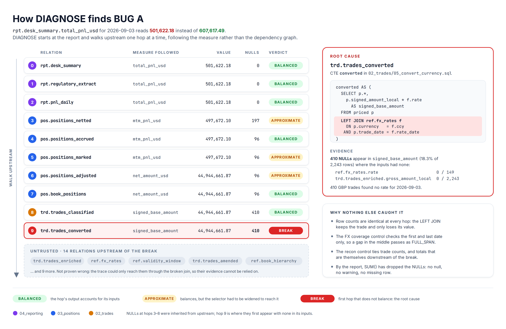
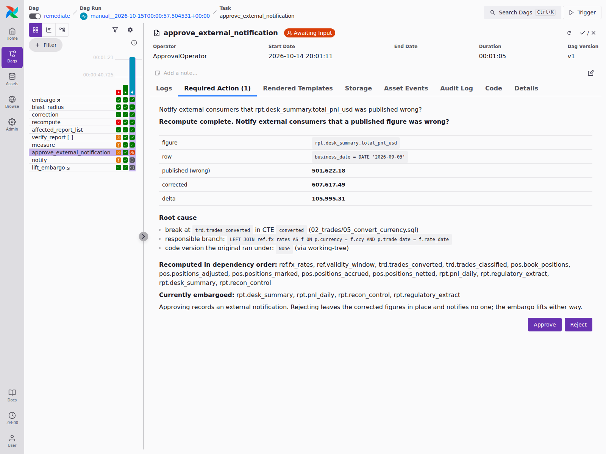
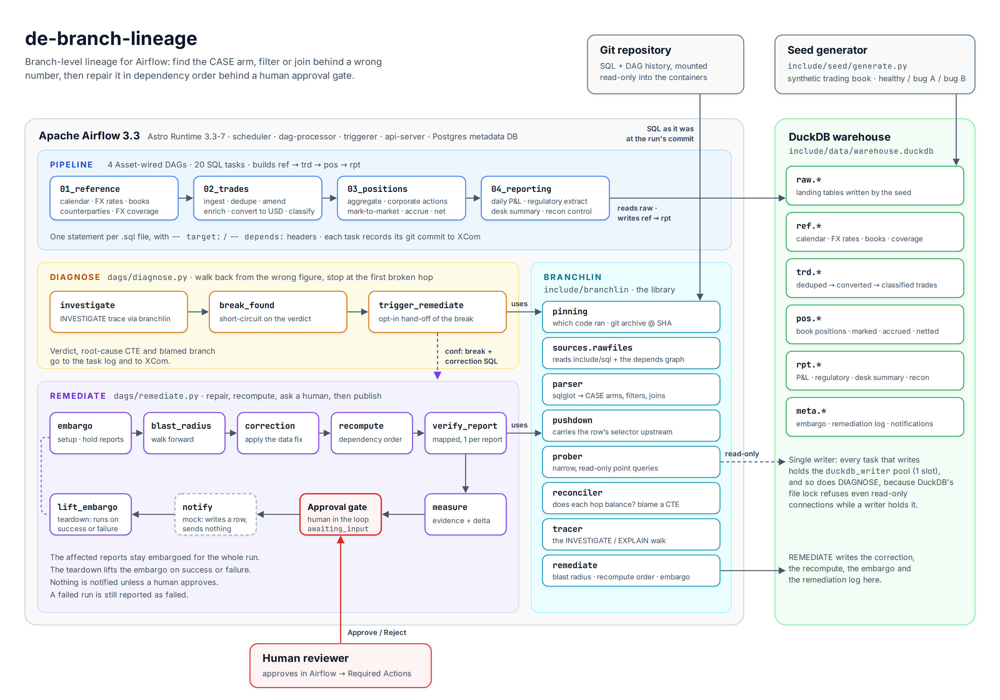

# de-branch-lineage

**Branch-level lineage for Apache Airflow.** When a number on a report is wrong,
de-branch-lineage walks backwards through the SQL that produced it and names the
exact `CASE` arm, `WHERE` predicate or `JOIN` responsible. It then repairs the
data in dependency order, behind a human approval gate.


---

## The problem

Existing lineage tools work at the column level. They can tell you that
`net_amount` derives from `amt_net`. They can't tell you **which branch a row
took**: which `CASE` arm evaluated, which filter excluded it, or which join
found no match.

That's usually the question that matters when a figure is wrong. dbt's own
column-level lineage documentation says it reflects lineage from `SELECT`
statements and "doesn't reflect other usage like joins and filters". Today,
finding one of those faults means a person working backwards through ten or more
steps by hand, often after the wrong number has already been published.

## What we set out to build

1. **A diagnosis that names the branch.** Given only a wrong value on a report,
   find the first step that doesn't account for its inputs, and blame the
   specific SQL construct inside it, down to the CTE.
2. **A test bed that matches how real faults behave.** That means a
   production-shaped pipeline with planted faults that defeat its own controls.
   The SQL must be byte-identical in the healthy and broken states, because in
   practice the code doesn't change; the data does.
3. **Knowledge of which code ran.** A diagnosis should read the SQL as it was
   when the wrong figure was produced, not as it is today.
4. **A repair that's safe even when it fails.** Hold back the affected reports,
   recompute them in the right order, and ask a human before telling anyone
   outside. Clean up whether the repair succeeds or fails.

## How we did it

### DIAGNOSE: walk back from the wrong number



DIAGNOSE starts at the report and moves upstream one relation at a time. At
each hop it runs narrow, read-only probes and asks whether the output accounts
for the input. The probes check:

- whether NULLs appeared where the inputs had none
- whether the sums still tie
- whether row counts hold

The first hop that fails is the **root cause**. The parser (built on sqlglot)
then attributes the failure to the CTE and branch point responsible. Everything
upstream is marked **untrusted**, because the trace could only reach it through
broken logic.

The path is **discovered, not declared.** The walk follows the measure rather
than the `-- depends:` graph. The graph offers five routes from `ref.fx_rates`
to the report, and only one of them carries the amount.

DIAGNOSE has two modes. **INVESTIGATE** stops at the first break. **EXPLAIN**
never stops: it walks all the way to the raw tables, annotating the branch each
row took, which is useful for audits and onboarding.

### REMEDIATE: fix it without making things worse

REMEDIATE is an Airflow DAG with a setup/teardown pair around the repair:

```
SETUP     embargo        mark the affected reports not-for-publication
TASK      blast_radius   walk forward from the corrected table
TASK      correction     apply the operator-supplied data fix
TASK      recompute      rebuild the affected relations in dependency order
TASK      verify_report  one mapped task per affected report
TASK      measure        read the corrected figure and build the evidence
GATE      approval       ApprovalOperator: waits in awaiting_input for a human
TASK      notify         MOCKED: records a row, sends nothing
TEARDOWN  lift_embargo   runs on success or failure
```

The reviewer sees the wrong figure, the corrected figure, the difference and
the root cause before deciding:



The **failure path** is tested as carefully as the happy path. If the recompute
dies part-way, all of the following hold:

- the run is reported **failed**
- the embargo is **still lifted**
- the approval gate is **never reached**
- **nothing is notified**
- the reports keep their original figure rather than a half-recomputed one

A plain script would need its own `finally`, and would still lose if the process
were killed. That guarantee is the main reason this runs inside an orchestrator.

### Which code ran

Each pipeline task records the git commit it ran under. `branchlin.pinning` is
meant to resolve that commit and read the SQL at it with `git archive`. When it
can't establish a version, the trace says **`UNPINNED`** rather than quietly
using today's code. Version pinning doesn't fully work in live Airflow runs yet;
see [Known limitations](#known-limitations).

## Architecture



| Component | What it is |
|---|---|
| **Pipeline** | 20 SQL files in four modules (reference → trades → positions → reporting), run as four Airflow DAGs wired by Assets |
| **Seed generator** | Builds a synthetic trading book (~54,000 trades, 22 business days, 12 books, 5 currencies) and plants the bugs on demand |
| **`branchlin`** | The library: SQL source, parser, selector pushdown, prober, reconciler, tracer, version pinning and remediation helpers |
| **DIAGNOSE / REMEDIATE** | The two Airflow DAGs that put the library in front of an operator |
| **DuckDB** | The warehouse. A single-writer pool (`duckdb_writer`) serialises every task that touches it |

The full design is in **[docs/architecture.md](docs/architecture.md)**.

## Results

Two bugs are planted. Both survive the pipeline's own controls, and DIAGNOSE
finds both:

| | BUG A: a missing FX rate | BUG B: an off-by-one calendar |
|---|---|---|
| Kind of fault | a `LEFT JOIN` that finds no match | a half-open `WHERE` against a wrong end date |
| Effect on the report | **−105,995.31** on 2026-09-03 | **−22,017.08** on 2026-08-31 |
| Do row counts change? | no, at every one of 20 steps | no |
| Does the recon control catch it? | no, it passes cleanly | no |
| DIAGNOSE verdict | BREAK at `trd.trades_converted`, CTE `converted`, blamed on the `LEFT JOIN ref.fx_rates` | BREAK at `pos.positions_accrued`, CTE `accrued`, blamed on the accrual-window `WHERE` |
| After REMEDIATE | report restated to **607,617.49**, the healthy figure to the cent | — |

On a healthy warehouse DIAGNOSE reports **NO BREAK** across all 14 hops.

**167 tests pass**: 110 for the library, and 57 for DAG structure and both
orchestration paths, run against a live Airflow.

There's a screenshot walkthrough of a full live run in
**[docs/proof-of-concept.md](docs/proof-of-concept.md)**.

## Quickstart

You'll need Python 3.11+ (developed on 3.14), Docker and the
[Astro CLI](https://www.astronomer.io/docs/astro/cli/install-cli).

```bash
git clone https://github.com/msweta02/de-branch-lineage.git && cd de-branch-lineage

# 1. Without Airflow: build the warehouse, plant the bugs, run the library tests
python3 -m venv .venv
.venv/bin/pip install -r requirements.txt -r requirements-dev.txt
.venv/bin/python include/seed/generate.py          # healthy warehouse
.venv/bin/python include/runner.py                 # run all 20 SQL files
.venv/bin/python tests/verify_scenarios.py         # all four bug combinations
.venv/bin/python -m pytest tests/branchlin         # 110 tests

# 2. With Airflow: the DIAGNOSE and REMEDIATE DAGs
astro dev start                                    # UI on http://localhost:8080
```

To replay the demo step by step, including planting each bug, running DIAGNOSE,
approving REMEDIATE, the failure path and resetting, follow
**[docs/running-the-demo.md](docs/running-the-demo.md)**.

## Repository layout

```
dags/                     Airflow DAGs: 4 pipeline modules, diagnose, remediate
include/
  branchlin/              the library (parser, tracer, prober, reconciler, ...)
  sql/                    the pipeline: 20 SQL files in 4 modules
  seed/generate.py        synthetic data and the two planted bugs
  runner.py               runs the pipeline outside Airflow
  pipeline_dag.py         builds one pipeline DAG per SQL module
  dbt_fixture/            a small dbt project reproducing BUG A in dbt
tests/
  branchlin/              library tests (run on the host)
  dags/                   DAG integrity and orchestration tests (run in Airflow)
  verify_scenarios.py     rebuilds and measures all four bug combinations
docs/                     documentation, diagrams and screenshots
airflow_settings.yaml     the DuckDB connection, pool and variable the DAGs need
docker-compose.override.yml   mounts .git read-only into the containers
```

## Documentation

| Document | For |
|---|---|
| [docs/architecture.md](docs/architecture.md) | How the system fits together and why it is shaped this way |
| [docs/running-the-demo.md](docs/running-the-demo.md) | Step-by-step: set up, simulate each bug, rerun, test, reset, troubleshoot |
| [docs/proof-of-concept.md](docs/proof-of-concept.md) | Screenshots and logs from a recorded live run |
| [docs/planted-bugs.md](docs/planted-bugs.md) | The two bugs in detail, and why every control misses them |
| [docs/technical-reference.md](docs/technical-reference.md) | Runtime versions, module reference, test matrix, known issues |
| [docs/overview-for-non-engineers.md](docs/overview-for-non-engineers.md) | The project in plain language |
| [docs/build-log.md](docs/build-log.md) | The engineering journal: what broke, what surprised us, what changed |

## Runtime

| | |
|---|---|
| Astro Runtime | `3.3-7` (Airflow **3.3.1**, Task SDK 1.3.1, Python 3.14.7) |
| Warehouse | DuckDB 1.5.5 |
| SQL parser | sqlglot 30.18.0 |

**Why Airflow 3.3.** From 3.3 the scheduler parks a human-in-the-loop task in
`awaiting_input` directly. On 3.1 and 3.2 the task defers onto the triggerer,
which makes the approval gate depend on a healthy triggerer process. Backporting
would change the gate and nothing else.

## Known limitations

- **Version pinning doesn't work from inside a running task yet.** On Airflow
  3.3.1, `branchlin.pinning` looks up the `DagRun` through the ORM, which task
  processes aren't allowed to do. Live DIAGNOSE runs therefore report
  `UNPINNED` and fall back to the working tree. Pinning does resolve when called
  outside a task. The fix is to read the recorded version through the Task SDK
  or the REST API. Details are in
  [docs/technical-reference.md](docs/technical-reference.md#known-issues).
- **CTE-level evidence is static.** CTEs aren't materialised, so a break is
  located inside a CTE by analysis and confirmed at the relation that contains
  it.
- **No near-miss explanations.** DIAGNOSE can say that a row fell to an `ELSE`
  arm, but not that it missed a cut-off by one day.
- **Pushdown is coarse.** Window, aggregate and `CASE` selectors widen to the
  whole relation. That's safe, but it does more work than it needs to.
- **The notification is mocked.** Approving records a row and contacts no one.
  Wire a real channel only behind the approval gate.
- **No custom UI.** Airflow's Required Actions view is where the human decision
  happens.

## License

[Apache-2.0](LICENSE)
