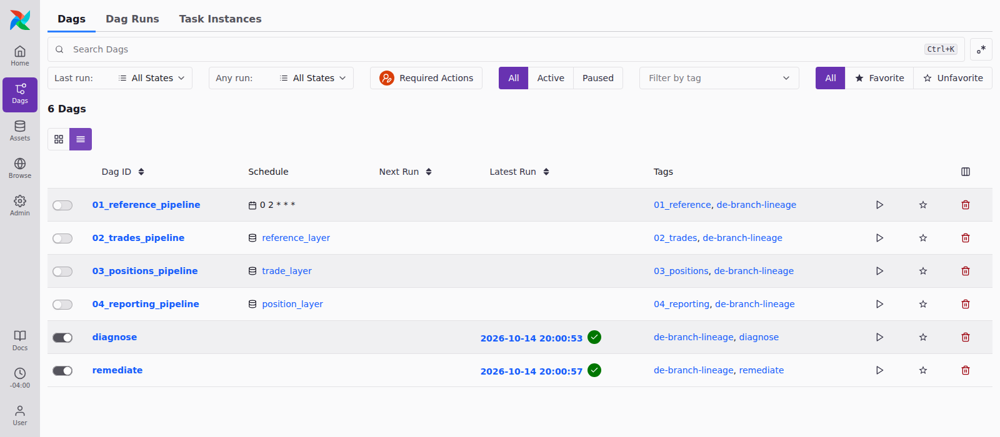
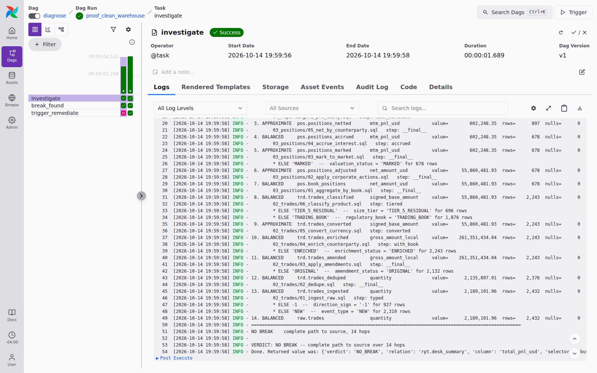
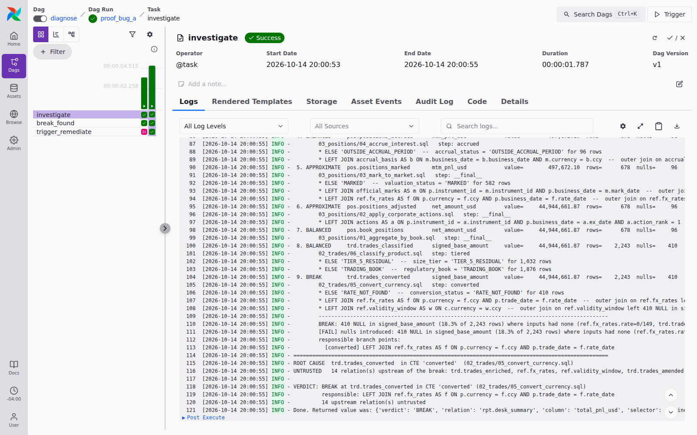
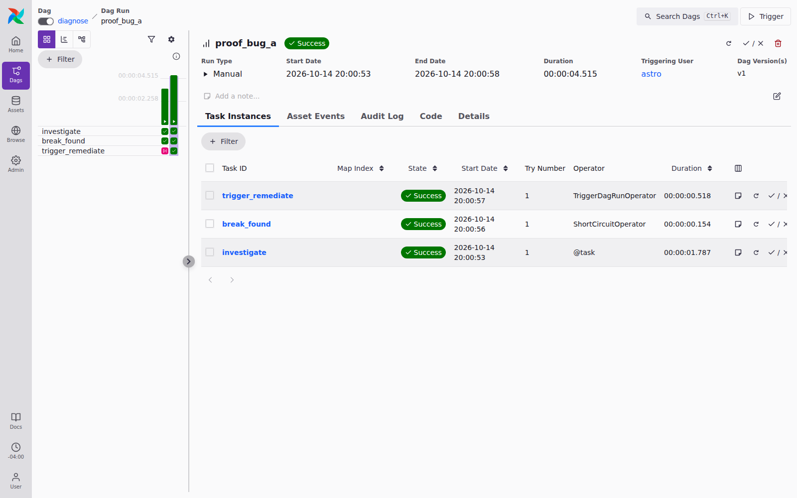
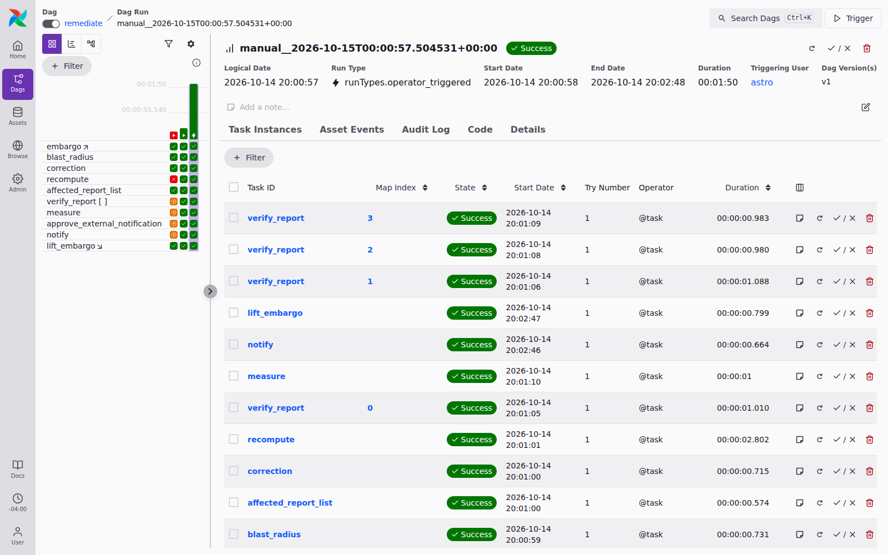
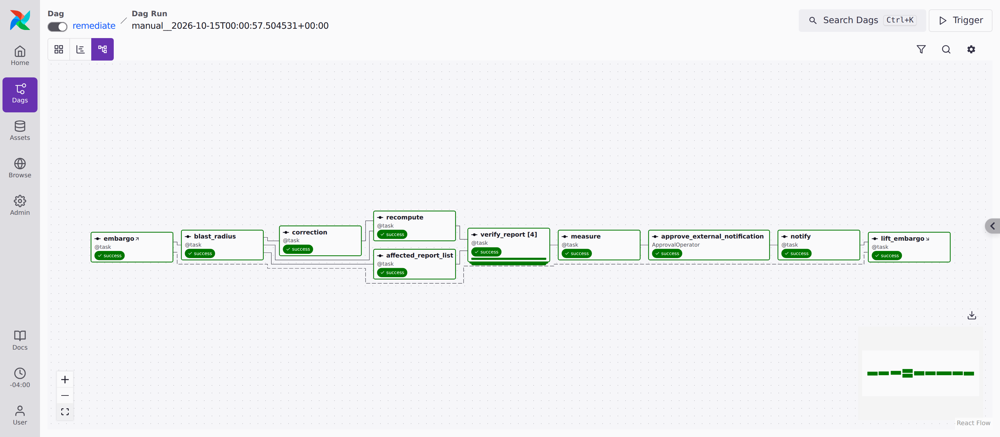

# Proof of concept: a live run

**Recorded 2026-10-14 · branch `phase-2-remediate` · commit `f83fa0a`**

This document records one end-to-end run of de-branch-lineage in a live Airflow
3.3 environment (`astro dev start`), with screenshots taken from the Airflow UI
during the run. It shows three things:

1. **DIAGNOSE stays quiet on a healthy warehouse.**
2. **DIAGNOSE finds a planted bug** (BUG A, a missing FX rate that a `LEFT JOIN`
   turns into NULLs) and locates the CTE responsible.
3. **REMEDIATE corrects it:** it embargoes the affected reports, recomputes them
   in dependency order, waits for a human approval, then publishes the corrected
   figure and lifts the embargo.

The headline figure is `rpt.desk_summary.total_pnl_usd` for business date
2026-09-03:

| state | value (USD) |
|---|---|
| published with BUG A (wrong) | 501,622.18 |
| after REMEDIATE | **607,617.49** |
| delta | 105,995.31 |

607,617.49 is the figure the healthy pipeline produces, and 105,995.31 matches
the delta measured independently by seeding the bug and comparing against a
healthy run (see [planted-bugs.md](planted-bugs.md)).

---

## 1. Test suite

Run before the live walkthrough, in the same environment.

| suite | where | result |
|---|---|---|
| `branchlin` library | host `.venv` | **110 passed** |
| all four bug scenarios (`tests/verify_scenarios.py`) | host `.venv` | expected counts at every hop, for example 410 NULLs at `trd.trades_converted` under BUG A |
| full suite, nothing skipped | scheduler container | **167 passed** (see note) |

**Note on the 167.** On the first run, 159 passed and 8 errored. All 8 are in
`TestHappyPath` and come from one fixture: `remediate` was **paused**, because
Airflow pauses new DAGs by default in a fresh environment. `TestFailurePath`
uses `airflow dags test`, which runs even when a DAG is paused, so it passed.
`TestHappyPath` uses `airflow dags trigger`, which needs the scheduler to pick
the run up, so its run stayed `queued` until the 180 s timeout. After
`airflow dags unpause remediate`, the 8 tests passed (`8 passed in 36.63s`).
This is an environment step, not a code defect. It is now part of the setup in
[running-the-demo.md](running-the-demo.md#3-with-airflow).

---

## 2. The DAGs



There are four pipeline DAGs (reference → trades → positions → reporting,
wired by Assets) and the two product DAGs, `diagnose` and `remediate`. The
latest runs of both product DAGs, shown here, are the ones recorded below.

---

## 3. DIAGNOSE on a healthy warehouse: no break

The warehouse was seeded healthy and the pipeline run, then `diagnose` was
triggered with its defaults (run id `proof_clean_warehouse`).



The trace walks 14 hops from `rpt.desk_summary` back to `raw.trades`, and every
hop balances:

```
14. BALANCED     raw.trades                 quantity               value=      2,189,101.96  rows=    2,432  nulls=      0
====================================================================================================
NO BREAK    complete path to source, 14 hops

VERDICT: NO BREAK -- complete path to source over 14 hops
```

`break_found` returned false, so `trigger_remediate` was skipped. Nothing is
remediated when nothing is broken.

---

## 4. DIAGNOSE with BUG A: the break is found

The warehouse was reseeded with `--bug-a` and the pipeline rerun. `diagnose`
was triggered with `trigger_remediate: true` and the GBP late-redelivery
correction as `correction_sql` (run id `proof_bug_a`).



```
 9. BREAK        trd.trades_converted       signed_base_amount     value=     44,944,661.87  rows=    2,243  nulls=    410
        02_trades/05_convert_currency.sql   step: converted
        * ELSE 'RATE_NOT_FOUND'  --  conversion_status = 'RATE_NOT_FOUND' for 410 rows
        * LEFT JOIN ref.fx_rates AS f ON p.currency = f.ccy AND p.trade_date = f.rate_date
        BREAK: 410 NULL in signed_base_amount (18.3% of 2,243 rows) where inputs had none
        responsible branch points:
          [converted] LEFT JOIN ref.fx_rates AS f ON p.currency = f.ccy AND p.trade_date = f.rate_date
ROOT CAUSE  trd.trades_converted  in CTE 'converted'  (02_trades/05_convert_currency.sql)
UNTRUSTED   14 relation(s) upstream of the break

VERDICT: BREAK at trd.trades_converted in CTE 'converted' (02_trades/05_convert_currency.sql)
         responsible: LEFT JOIN ref.fx_rates AS f ON p.currency = f.ccy AND p.trade_date = f.rate_date
```

The verdict names the relation, the CTE inside the file, and the join
condition that let 410 trades through with no rate.

Because a break was found and remediation was requested, `trigger_remediate`
fired:



---

## 5. REMEDIATE waits at the approval gate

REMEDIATE embargoed the four affected reports, applied the correction,
recomputed 13 relations in dependency order, checked each report, measured the
result, and then **stopped** at `approve_external_notification` in state
`awaiting_input`. The Required Action tab shows the reviewer the evidence:


The reviewer sees the wrong figure, the corrected figure, the delta, the root
cause down to the CTE and join condition, the recompute order, and which
reports are under embargo. They decide with the evidence in front of them.

The **Approve** button in this screenshot was clicked in the UI to continue the
run.

---

## 6. REMEDIATE completes





The dashed edges in the graph are the setup/teardown pair: `embargo` is the
setup and `lift_embargo` is the teardown. The teardown runs whether the
remediation succeeds or fails, so a report is never left embargoed.

Task logs after approval:

```
notify:
  NOTIFICATION RECORDED (mock, nothing sent): ('…', 'MOCK', 'external-consumers@example.invalid',
                                               'Restatement: rpt.desk_summary.total_pnl_usd for 2026-09-03')
  Done. Returned value was: {'notifications': 1}

lift_embargo:
  EMBARGO LIFTED on 4 relation(s): rpt.desk_summary, rpt.pnl_daily, rpt.recon_control, rpt.regulatory_extract
  still embargoed by other runs: nothing
```

## 7. The warehouse afterwards

Read directly from DuckDB after the run:

```
desk_summary 2026-09-03 total: 607617.49
GBP rate row:  (2026-09-03, 'GBP', 1.270854, 'LATE_REDELIVERY')
null converted: 0
```

The missing rate has been redelivered, no trade is left unvalued, and the
report reads the healthy figure.

---

## Caveats

- **The notification is a mock.** `notify` records a `MOCK` row and sends
  nothing. That is by design for a local proof.
- **Code version shows `None (via working-tree)`** in the evidence panel, and
  the DIAGNOSE log says `UNPINNED -- not the code that ran`. Here, the warehouse
  was built with `runner.py`, so no pipeline task recorded a commit. A
  follow-up run that built the warehouse through the pipeline DAGs still
  reported `UNPINNED`: the version lookup in `branchlin.pinning` uses the
  Airflow ORM, which Airflow 3.3.1 forbids inside a task (`Direct database
  access via the ORM is not allowed`). The trace labels this honestly rather
  than presenting today's code as the code that ran. See
  [technical-reference.md](technical-reference.md#known-issues).
- **Two DAG runs were deleted before the screenshots.** In a first attempt, the
  `correction_sql` passed to DIAGNOSE was truncated (missing its closing
  parenthesis) by the shell command used to build it. That REMEDIATE run
  failed at `correction`, nothing downstream ran, and `lift_embargo` still
  lifted the embargo, which is the designed failure behaviour. That run and
  its DIAGNOSE parent were deleted, and the scenario was rerun with the
  correction SQL read directly from `dags/remediate.py`.
- **Older runs appear in the grid.** The left-hand grid in the REMEDIATE
  screenshots also shows two earlier runs from the test suite: the rigged
  failure-path run (red `recompute`) and a happy-path run.
- **The warehouse was restored afterwards.** It was reseeded healthy and the
  pipeline rerun, so it is in the baseline state.

## Reproducing this

Every step above, with copy-paste commands, is in
**[running-the-demo.md](running-the-demo.md)**. Scenario A is the healthy
diagnosis, Scenario B is BUG A through approval, and Scenario D is the failure
path.
